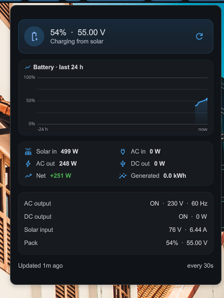

# Bluetti AC200MAX Monitor

Real-time monitoring, historical analytics, and remote control for a Bluetti AC200MAX portable power station over Bluetooth Low Energy (BLE). The system reads telemetry via Modbus-over-BLE, stores it in MariaDB, and serves an interactive web dashboard for visualization and device control.

Built with assistance from [GLM 5.1](https://github.com/THUDM/GLM-5.1) AI model.


## Table of Contents

- [Architecture](#architecture)
- [Technology Stack](#technology-stack)
- [Requirements](#requirements)
- [Installation](#installation)
- [Usage](#usage)
- [Rust Collector](#rust-collector)
- [DMS Desktop Widget](#dms-desktop-widget)
- [Modbus Register Map](#modbus-register-map)
- [KPIs](#kpis)
- [Dashboard](#dashboard)
- [API Reference](#api-reference)
- [Remote Control](#remote-control)
- [Docker Deployment](#docker-deployment)
- [Project Structure](#project-structure)
- [Environment Variables](#environment-variables)
- [Troubleshooting](#troubleshooting)

---

## Architecture

```
┌─────────────────────────────────────────────────────────────────┐
│                         Host Machine                            │
│                                                                 │
│  ┌──────────────┐  BLE/GATT   ┌───────────────────────┐        │
│  │              │◄────────────►│  Bluetti AC200MAX     │        │
│  │  bluetti_    │  Modbus RTU  │  (CF:DD:53:11:F4:72)  │        │
│  │  reader.py   │              └───────────────────────┘        │
│  │              │                                               │
│  │  - Read      │  TCP 3390    ┌───────────────────────┐        │
│  │  - Write     │─────────────►│  MariaDB Container    │        │
│  │  - Auto-     │              │  (Bluetti_AC200MAX db)│        │
│  │    reconnect │              └───────────────────────┘        │
│  │              │                      │                        │
│  └──────┬───────┘                      │ mysql2/promise         │
│         │                              │                        │
│         │ CSV                          │                        │
│         ▼                              ▼                        │
│  ┌──────────────┐              ┌───────────────────────┐        │
│  │  data.csv    │              │  dashboard/server.ts  │        │
│  └──────────────┘              │  (Bun, port 5000)     │        │
│                                │                       │        │
│                                │  - Static file serve  │        │
│                                │  - /api/data          │        │
│                                │  - /api/dates         │        │
│                                │  - /api/toggle        │────────┼──► execFile()
│                                └───────────┬───────────┘        │  bluetti_reader.py
│                                            │                    │  (--dc-on, --ac-off, ...)
│                                            ▼                    │
│                                ┌───────────────────────┐        │
│                                │  dashboard/index.html │        │
│                                │  (Chart.js + date-fns)│        │
│                                └───────────────────────┘        │
│                                                                 │
└─────────────────────────────────────────────────────────────────┘
```

### Data Flow

1. **`bluetti_reader.py`** connects to the AC200MAX over BLE every 60 seconds (configurable)
2. It reads three register blocks via Modbus RTU (function code `0x03`): registers 10-49, 70-90, and 91-127
3. Parsed values are written to both **CSV** (`data.csv`) and **MariaDB** (with auto-schema migration)
4. The dashboard backend (`server.ts`) queries MariaDB and serves JSON APIs
5. The frontend renders interactive charts via Chart.js with 10-second auto-refresh

### Control Flow

1. Dashboard toggle buttons send POST to `/api/toggle`
2. `server.ts` calls `execFile()` to run `bluetti_reader.py` with write flags
3. `bluetti_reader.py` connects over BLE, sends Modbus Write Single Register (function code `0x06`)
4. The device confirms the write with an echo response

---

## Technology Stack

| Component | Technology | Version |
|---|---|---|
| BLE Client | [bleak](https://github.com/hbldh/bleak) | 2.0.0 |
| CRC | [crcmod](https://pypi.org/project/crcmod/) | 1.7 |
| Database Driver | [PyMySQL](https://pypi.org/project/PyMySQL/) | 1.1.3 |
| Database | [MariaDB](https://mariadb.org/) | latest (Docker) |
| Runtime (Python) | Python | 3.13+ |
| Web Server | [Bun](https://bun.sh/) | latest |
| DB Client (TS) | [mysql2](https://github.com/sidorares/node-mysql2) | ^3.22.3 |
| Charts | [Chart.js](https://www.chartjs.org/) | 4.x (UMD) |
| Date Adapter | [chartjs-adapter-date-fns](https://github.com/chartjs/chartjs-adapter-date-fns) | 3.x |
| Date Library | [date-fns](https://date-fns.org/) | 3.x |
| Containerization | Docker + Docker Compose | - |

---

## Requirements

### Hardware

- Bluetti AC200MAX power station
- Bluetooth LE adapter on the host machine (e.g., built-in BT on Raspberry Pi, USB BT dongle)
- The device must be within BLE range (~10m)

### Software

- Python 3.13+
- Bun runtime
- Docker & Docker Compose (for MariaDB)
- Bluetooth stack (`bluez` on Linux)

### Python Dependencies

```
pip install bleak==2.0.0 crcmod==1.7 PyMySQL==1.1.3
```

### Optional (for static graph generation)

```
pip install matplotlib pandas
```

---

## Installation

### 1. Clone the repository

```bash
git clone <repo-url>
cd bluetti
```

### 2. Start MariaDB

```bash
docker compose up -d db
```

Wait for the database to be ready:

```bash
docker exec bluetti-db-1 mariadb -uroot -pkilroy -e "SELECT 1"
```

### 3. Install Python dependencies

```bash
pip install bleak crcmod PyMySQL
```

### 4. Install Bun and dashboard dependencies

```bash
cd dashboard
bun install
```

### 5. Scan for your device

```bash
python bluetti_reader.py --scan
```

Note the MAC address (e.g., `CF:DD:53:11:F4:72`).

### 6. Start everything

```bash
./start.sh
```

Or manually:

```bash
# Terminal 1: Reader (continuous, every 60s)
python bluetti_reader.py -a CF:DD:53:11:F4:72 --csv data.csv --mysql --loop 0 --interval 60

# Terminal 2: Dashboard
cd dashboard && bun run server.ts
```

Open http://localhost:5000

---

## Usage

### Reading Data

```bash
# One-shot read
python bluetti_reader.py -a CF:DD:53:11:F4:72

# Continuous polling every 10 seconds
python bluetti_reader.py -a CF:DD:53:11:F4:72 --loop 0 --interval 10

# Log to CSV + MySQL (defaults: 1440 readings, 60s interval)
python bluetti_reader.py -a CF:DD:53:11:F4:72 --csv data.csv --mysql --loop 0 --interval 60
```

### Controlling Outputs

```bash
# Turn DC output ON/OFF
python bluetti_reader.py -a CF:DD:53:11:F4:72 --dc-on
python bluetti_reader.py -a CF:DD:53:11:F4:72 --dc-off

# Turn AC output ON/OFF
python bluetti_reader.py -a CF:DD:53:11:F4:72 --ac-on
python bluetti_reader.py -a CF:DD:53:11:F4:72 --ac-off
```

### Importing Historical CSV Data

```bash
python import_csv.py --csv data.csv
```

### Generating Static Graphs

```bash
python graph.py --input data.csv
# Produces: data_power.png, data_battery.png
```

---

## Rust Collector

`rust/` contains `bluetti-reader`, a Rust port of `bluetti_reader.py` with the same register map,
CSV columns, KPI definitions and CLI flags — and no virtualenv to keep alive. It is the collector
used in production here.

```bash
cd rust
cargo build --release
cargo test                      # CRC, framing, decoding and KPI maths

./target/release/bluetti-reader --scan
./target/release/bluetti-reader -a <MAC> --mysql --loop 0 --interval 60
```

**BLE link handling.** The AC200MAX accepts exactly one BLE connection, and on Linux the ACL link
belongs to `bluetoothd` rather than to the process that opened it — a reader killed with SIGKILL
leaves the device stuck at `Connected: yes`, locking out the phone app and every other client.
The Rust collector therefore:

- connects, reads the three register blocks, and **disconnects around every capture**, so between
  readings the device's single connection slot is free (~4 s connected per 60 s period);
- releases the link on error paths as well as the success path;
- handles SIGINT/SIGTERM so `systemctl stop` disconnects cleanly instead of orphaning the link.

### Running it as a systemd service

`rust/systemd/bluetti-reader.service` is a **user** unit — Bluetooth, the MariaDB container and the
desktop widget all live in the user session.

```bash
systemctl --user enable --now ~/DEV/bluetti/rust/systemd/bluetti-reader.service
systemctl --user status bluetti-reader
journalctl --user -u bluetti-reader -f
```

It polls every 60 s into MariaDB. Override the MAC or database settings in
`~/.config/bluetti/collector.env` rather than editing the unit. `TimeoutStopSec=120` is deliberate:
a stop must leave the reader room to finish its Modbus cycle and disconnect.

Stop the service before running any other reader — one connection, one client.

See [`rust/README.md`](rust/README.md) for the full details.

---

## DMS Desktop Widget

`dmsplugin/bluettiMonitor/` is a plugin for [DankMaterialShell](https://github.com/AvengeMedia/DankMaterialShell)
(DMS), the Quickshell-based Wayland desktop shell. It puts the power station in the DankBar:
battery percentage plus net charge/discharge power, green when charging and red when discharging.


Clicking it opens a popout with the full picture — a 24 hour battery chart, the power breakdown,
AC/DC details and pack state:



*(The chart only covers the stretch where the collector was running; the window is always a full
24 hours, so gaps in collection show as gaps.)*

The widget queries MariaDB directly with the `mariadb` client every 10 s — it never touches
Bluetooth, so it cannot compete with the collector for the device's single BLE connection. Net
power is recomputed in the widget rather than read from the stored column, and readings older than
the stale threshold are visibly flagged instead of being shown as current.

### Install

```bash
./dmsplugin/bluettiMonitor/install.sh
dms ipc plugins enable bluettiMonitor
```

Then add `bluettiMonitor` to a bar section in DMS Settings, or insert
`{"id": "bluettiMonitor", "enabled": true}` into one of `barConfigs[0].leftWidgets` /
`centerWidgets` / `rightWidgets` in `~/.config/dms/settings.json`.

Note that writing `"enabled": true` into `plugin_settings.json` by hand does **not** enable a
plugin in a running shell — the enable must go through `dms ipc plugins enable`.

See [`dmsplugin/bluettiMonitor/README.md`](dmsplugin/bluettiMonitor/README.md) for the settings
reference.

---

## Modbus Register Map

Communication uses Modbus RTU framing over BLE GATT characteristics:
- **Write UUID**: `0000ff02-0000-1000-8000-00805f9b34fb`
- **Notify UUID**: `0000ff01-0000-1000-8000-00805f9b34fb`
- **Unit ID**: `0x01`

### Read Registers (Function Code 0x03)

| Register | Field | Type | Unit | Notes |
|---|---|---|---|---|
| 10-15 | `device_type` | String (6 regs) | - | e.g., "AC200M" |
| 23-24 | `arm_version` | Version (2 regs) | - | /100 |
| 25-26 | `dsp_version` | Version (2 regs) | - | /100 |
| 36 | `dc_input_power` | Uint16 | W | DC input (solar) |
| 37 | `ac_input_power` | Uint16 | W | AC input (grid) |
| 38 | `ac_output_power` | Uint16 | W | AC output (load) |
| 39 | `dc_output_power` | Uint16 | W | DC output (load) |
| 41 | `power_generation` | Decimal (x0.1) | kWh | Cumulative |
| 43 | `total_battery_percent` | Uint16 | % | Range-checked 0-100 |
| 48 | `ac_output_on` | Bool | - | 1=ON, 0=OFF |
| 49 | `dc_output_on` | Bool | - | 1=ON, 0=OFF |
| 70 | `ac_output_mode` | Uint16 | - | 0=STOP, 1=Inverter, 2=Bypass C, 3=Bypass D, 4=Load Match |
| 71 | `internal_ac_voltage` | Uint16 | V | AC voltage |
| 72 | `internal_current_one` | Decimal (x0.1) | A | AC current |
| 73 | `internal_power_one` | Uint16 | W | AC power |
| 74 | `internal_ac_frequency` | Uint16 | Hz | AC frequency |
| 86 | `internal_dc_input_voltage` | Uint16 | V | DC voltage |
| 87 | `internal_dc_input_power` | Decimal (x0.1) | W | DC power |
| 88 | `internal_dc_input_current` | Decimal (x0.01) | A | DC current |
| 91 | `pack_num_max` | Uint16 | - | Max battery packs |
| 92 | `total_battery_voltage` | Decimal (x0.01) | V | Total pack voltage |
| 96 | `pack_num` | Uint16 | - | Current pack count |
| 98 | `pack_voltage` | Decimal (x0.01) | V | Individual pack voltage |
| 99 | `pack_battery_percent` | Uint16 | % | Pack charge % |

### Write Registers (Function Code 0x06)

| Register | Field | Value | Effect |
|---|---|---|---|
| 48 | AC output control | `1` = ON, `0` = OFF | Toggle AC inverter |
| 49 | DC output control | `1` = ON, `0` = OFF | Toggle DC output (USB, 12V, etc.) |

### Polling Strategy

Three register blocks are read per cycle to minimize BLE transactions:

```
Block 1: registers 10-49  (40 registers - device info + power + battery + output states)
Block 2: registers 70-90  (21 registers - AC/DC detail metrics)
Block 3: registers 91-127  (37 registers - battery pack details)
```

Each read is retried up to 3 times with a 10-second response timeout.

---

## KPIs

The system computes several derived KPIs from raw register values:

### Charging State

Computed from DC and AC input power (threshold: 5W):

| State | Value | Condition |
|---|---|---|
| Not Charging | 0 | DC input <= 5W AND AC input <= 5W |
| DC Charging | 1 | DC input > 5W |
| AC Charging | 2 | AC input > 5W |
| AC+DC Charging | 3 | Both DC and AC > 5W |

### Net Power

```
Net Power = DC Input Power - DC Output Power
```

Positive = net charging, Negative = net discharging. Displayed as a colored badge (green/red) next to the Today button in the dashboard.

### Power Rate

Based on net power when charging:

| Rate | Value | Net Power Range |
|---|---|---|
| Trickle | 0 | < 100W |
| Normal | 1 | 100W - 500W |
| Fast | 2 | > 500W |

### Battery Range

| Range | Value | Battery % |
|---|---|---|
| 0-25% | 0 | 0-25% |
| 25-50% | 1 | 26-50% |
| 50-75% | 2 | 51-75% |
| 75-100% | 3 | 76-100% |

### Prediction

The dashboard computes a linear charge completion prediction:

- **Charge rate**: Average % change per minute over the selected day's data
- **Full At**: Estimated time to reach 100% charge
- **Minutes remaining**: `(100 - current%) / rate per minute`

### Daily Totals

Aggregated per day from individual readings:

- **Produced**: Sum of DC input power readings
- **Used**: Sum of AC output + DC output power readings
- **Charge/Discharge time**: Total time in each state (hours)
- **Rate breakdown**: Time in Trickle/Normal/Fast modes (hours)

---

## Dashboard

The web dashboard is a single-page application served at `http://localhost:5000`.

### Layout

```
┌──────────────────────────────────────────────────────────────────┐
│  Header: Title  |  DC Toggle  AC Toggle  |  Last update + count │
├──────────────────────────────────────────────────────────────────┤
│  Calendar: ◄  Month Year  ►  [day grid]  [Today] [Net: +142W]  │
├──────────────────────────────────────────────────────────────────┤
│  Prediction Bar (green=charging / red=discharging)               │
│  Battery Now | Charge Rate | Estimated Full Time                 │
├──────────────────────────────────────────────────────────────────┤
│  KPI Row (auto-fit grid)                                         │
│  Battery% | Voltage | DC Input | AC Output | DC Voltage | ...    │
│  AC Current | AC Freq | AC Output State | Charging Mode | ...    │
│  Net Power | Charge Rate | Battery Range | Produced | Used       │
├──────────────────────────────────────────────────────────────────┤
│  Charts (2-column grid)                                          │
│  ┌─ Battery ──────────┐  ┌─ Power Flow ────────────┐            │
│  │ Battery % (line)   │  │ DC In/AC Out (bar)       │            │
│  │ Voltage (line, y2) │  │ Battery % (line, y2)     │            │
│  └────────────────────┘  └─────────────────────────┘            │
│  ┌─ DC Input (Solar)──┐  ┌─ AC Output ────────────┐             │
│  │ Power/Voltage/Curr │  │ Power/Voltage/Curr/Freq │             │
│  └────────────────────┘  └─────────────────────────┘             │
│  ┌─ Charging KPIs ────┐                                          │
│  │ Net Power + State  │                                          │
│  └────────────────────┘                                          │
├──────────────────────────────────────────────────────────────────┤
│  [Refresh]  [x] Auto-refresh (10s)                               │
└──────────────────────────────────────────────────────────────────┘
```

### Features

- **Calendar navigation**: Click any day with data to view historical charts
- **Today button**: Jumps to current date (uses local timezone)
- **Auto-refresh**: Polls every 10 seconds when viewing today's data
- **Date-aware**: Historical days show static data; today auto-updates
- **Output toggles**: DC and AC on/off buttons in the header (requires `BLUETTI_MAC`)
- **Net power badge**: Real-time net power indicator next to Today button
- **Prediction bar**: Charge/discharge rate and estimated completion time
- **Dark theme**: Optimized for low-light environments

---

## API Reference

### `GET /api/dates`

Returns all dates that have recorded data.

```json
{ "dates": ["2025-05-20", "2025-05-21", "2025-05-22"] }
```

### `GET /api/data?date=YYYY-MM-DD`

Returns readings, prediction, and daily totals for a specific date. Omit `date` for all data.

```json
{
  "rows": [
    {
      "timestamp": "2025-05-22 08:00:00",
      "total_battery_percent": 75,
      "total_battery_voltage": 48.32,
      "dc_input_power": 320,
      "ac_output_power": 150,
      "dc_output_power": 20,
      "ac_output_on": true,
      "dc_output_on": true,
      "net_power": 300,
      "charging_state": 1,
      "power_rate": 1,
      "battery_range": 2
    }
  ],
  "prediction": {
    "batteryNow": 75,
    "avgChargeRate": 5.2,
    "minsLeft": 480,
    "fullAt": "2025-05-22T16:00:00.000Z"
  },
  "dailyTotal": {
    "producedW": 19200,
    "usedW": 10200,
    "chargingTime": "8.0h",
    "dischargingTime": "0.0h"
  },
  "date": "2025-05-22"
}
```

### `POST /api/toggle`

Toggle DC or AC output on/off. Calls `bluetti_reader.py` via `execFile`.

**Request:**

```json
{ "output": "dc", "state": "on" }
```

**Response (success):**

```json
{ "ok": true, "msg": "DC output turned on" }
```

**Response (error):**

```json
{ "ok": false, "msg": "BLUETTI_MAC env var not set" }
```

**Parameters:**

| Field | Values | Description |
|---|---|---|
| `output` | `"dc"` or `"ac"` | Which output to toggle |
| `state` | `"on"` or `"off"` | Target state |

---

## Remote Control

The AC200MAX can be controlled both from the CLI and the web dashboard.

### CLI

```bash
python bluetti_reader.py -a <MAC> --dc-on     # Turn DC output ON
python bluetti_reader.py -a <MAC> --dc-off    # Turn DC output OFF
python bluetti_reader.py -a <MAC> --ac-on     # Turn AC inverter ON
python bluetti_reader.py -a <MAC> --ac-off    # Turn AC inverter OFF
```

### Web Dashboard

Toggle buttons appear in the header bar. They show the current state (green = ON, red = OFF) and flip on click. The state syncs from live data on each refresh.

**Setup:** Set the `BLUETTI_MAC` environment variable before starting the dashboard:

```bash
export BLUETTI_MAC=CF:DD:53:11:F4:72
cd dashboard && bun run server.ts
```

### Modbus Write Protocol

Write commands use Modbus function code `0x06` (Write Single Register):

```
Frame: [UnitID, 0x06, RegHi, RegLo, ValHi, ValLo, CRCLo, CRCHi]
Example (DC ON):  [0x01, 0x06, 0x00, 0x31, 0x00, 0x01, CRC, CRC]
```

The device echoes the register and value on success, or returns error code `0x86` on failure.

---

## Docker Deployment

### Build

```bash
docker build -t bluetti-monitor .
```

### Run (standalone)

```bash
docker run -d \
  --name bluetti \
  --net host \
  --cap-add NET_ADMIN \
  -v /path/to/data:/data \
  -e BLUETTI_MAC=CF:DD:53:11:F4:72 \
  bluetti-monitor
```

The `--net host` flag is required for Bluetooth access. The `--cap-add NET_ADMIN` may be needed for BLE scanning.

### Docker Compose (full stack with MariaDB)

The included `docker-compose.yml` starts only the database. To run the full stack:

```bash
# Start database
docker compose up -d db

# Start reader + dashboard on host (for BT access)
./start.sh
```

The Dockerfile uses a multi-stage build to embed the Bun runtime alongside Python, producing a single container that runs both the reader and the web server.

---

## Project Structure

```
bluetti/
├── bluetti_reader.py      # Main BLE reader/writer (Python)
├── graph.py                # Static PNG chart generation (matplotlib)
├── import_csv.py           # CSV-to-MariaDB importer
├── models.py               # Database schema definition
├── start.sh                # Startup script (DB + reader + dashboard)
├── run.bash                # Background reader launcher (with PID guard)
├── entrypoint.sh           # Docker entrypoint
├── Dockerfile              # Multi-stage Python+Bun container
├── docker-compose.yml      # MariaDB service definition
├── AGENTS.md               # AI agent context file
├── .gitignore
├── data.csv                # Telemetry CSV (gitignored)
├── rust/                   # Rust port of the reader (the production collector)
│   ├── Cargo.toml
│   ├── rustfmt.toml
│   ├── src/
│   │   ├── main.rs         # CLI, BLE transport, polling loop, output
│   │   ├── protocol.rs     # CRC, framing, register map, KPI maths (unit tested)
│   │   └── db.rs           # MariaDB schema bootstrap and inserts
│   └── systemd/
│       └── bluetti-reader.service   # systemd user unit, 60s polling
├── dmsplugin/
│   └── bluettiMonitor/     # DankMaterialShell bar widget
│       ├── plugin.json     # Plugin manifest
│       ├── BluettiWidget.qml    # Bar pill + popout with 24h battery chart
│       ├── BluettiSettings.qml  # Settings page
│       ├── install.sh      # Symlinks the plugin into ~/.config/dms/plugins
│       ├── bar.png         # Screenshot: bar pill
│       └── screenshot.png  # Screenshot: popout
├── dashboard/
│   ├── server.ts           # Bun web server + API endpoints
│   ├── index.html          # Single-page dashboard (Chart.js)
│   ├── package.json        # Bun dependencies (mysql2)
│   ├── bun.lock
│   ├── run-web.sh          # Dashboard launcher
│   ├── js/
│   │   ├── chart.umd.min.js           # Chart.js (local)
│   │   └── chartjs-adapter-date-fns.min.js  # Date adapter (local)
│   └── node_modules/
```

---

## Environment Variables

| Variable | Default | Description |
|---|---|---|
| `BLUETTI_DB_HOST` | `127.0.0.1` | MariaDB host |
| `BLUETTI_DB_PORT` | `3390` | MariaDB port |
| `BLUETTI_DB_USER` | `root` | MariaDB user |
| `BLUETTI_DB_PASSWORD` | `kilroy` | MariaDB password |
| `BLUETTI_DB_NAME` | `Bluetti_AC200MAX` | Database name |
| `BLUETTI_MAC` | *(empty)* | Device MAC address (required for web toggle) |

---

## Troubleshooting

### "No AC200MAX devices found"

- Ensure Bluetooth is enabled: `bluetoothctl show`
- Device must be powered on and within range (~10m)
- If previously paired, disconnect first: `bluetoothctl disconnect <MAC>`
- On Linux, you may need: `sudo hciconfig hci0 up`

### "MODBUS error for registers"

- The device may be busy or in a transition state; the reader retries 3 times
- Ensure no other app (e.g., Bluetti official app) is connected simultaneously

### "can't access property parseISO"

- The `date-fns` library must load before `chartjs-adapter-date-fns`
- Check browser console for CDN load failures
- The dashboard loads `date-fns` from CDN; for offline use, download it locally

### "BLUETTI_MAC env var not set"

- Set the environment variable before starting the dashboard for toggle functionality
- Alternatively, hardcode the MAC in `start.sh`

### BLE connection keeps dropping

- The reader has built-in auto-reconnect (10-second delay)
- Bluetooth on Linux can be unstable; consider a USB BLE dongle
- Check `bluetti.log` for reconnect patterns

### "Today" button shows wrong day

- Fixed as of latest version — the dashboard now uses local time instead of UTC
- If still seeing the issue, hard-refresh the browser (Ctrl+Shift+R)

---

## Database Schema

The `readings` table stores one row per polling interval:

| Column | Type | Description |
|---|---|---|
| `id` | INT AUTO_INCREMENT PK | Row ID |
| `timestamp` | DATETIME UNIQUE | Reading timestamp |
| `total_battery_percent` | INT | Battery charge % |
| `total_battery_voltage` | DECIMAL(10,4) | Total pack voltage |
| `ac_input_power` | INT | AC input watts |
| `dc_input_power` | INT | DC input watts (solar) |
| `ac_output_power` | INT | AC output watts (load) |
| `dc_output_power` | INT | DC output watts |
| `internal_ac_voltage` | DECIMAL(10,4) | AC voltage |
| `internal_current_one` | DECIMAL(10,4) | AC current |
| `internal_power_one` | INT | AC power |
| `internal_ac_frequency` | INT | AC frequency |
| `internal_dc_input_voltage` | DECIMAL(10,4) | DC voltage |
| `internal_dc_input_power` | DECIMAL(10,4) | DC power |
| `internal_dc_input_current` | DECIMAL(10,4) | DC current |
| `power_generation` | INT | Cumulative kWh |
| `ac_output_on` | TINYINT(1) | AC output state |
| `dc_output_on` | TINYINT(1) | DC output state |
| `pack_battery_percent` | INT | Pack charge % |
| `pack_voltage` | DECIMAL(10,4) | Pack voltage |
| `elapsed_seconds` | INT | Seconds since last reading |
| `charging_state` | TINYINT(1) | 0=None, 1=DC, 2=AC, 3=AC+DC |
| `battery_range` | TINYINT(1) | 0=0-25%, 1=25-50%, 2=50-75%, 3=75-100% |
| `net_power` | INT | (DC input + AC input) - (AC output + DC output) |
| `power_rate` | TINYINT(1) | 0=Trickle, 1=Normal, 2=Fast |

Indexed on `timestamp` for fast date-range queries.

---

## License

Personal project. No license specified.
