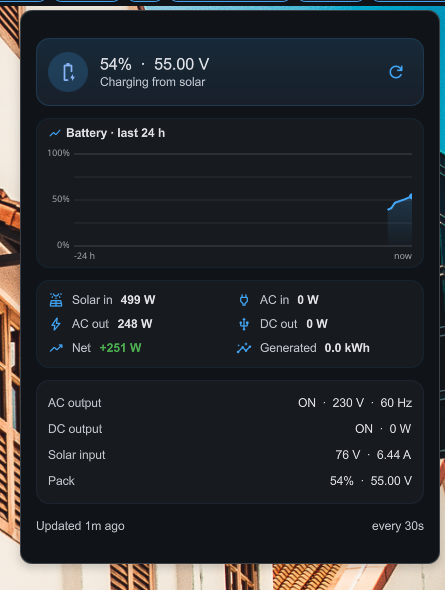

# Bluetti Monitor — DMS plugin

A DankBar widget for [DankMaterialShell](https://github.com/AvengeMedia/DankMaterialShell) that
shows the live state of the Bluetti AC200MAX: battery percentage and net charge/discharge power in
the bar, full detail in the popout.

The popout carries a 24 hour battery chart, the power breakdown, AC/DC details and pack state. The
chart window is always a full 24 hours anchored on the newest reading, so a stretch where the
collector was not running shows as a gap rather than being stretched to fill the axis.

## How it gets its data

The widget queries the local MariaDB archive directly with the `mariadb` client, taking the newest
row of the `readings` table and returning it as a single JSON document. No dashboard server is
involved. The query runs every 10 seconds (configurable, 5–120 s).

The 24 hour chart is a second query, refreshed every 60 s, averaging `total_battery_percent` into
10 minute buckets. Its window is anchored on the newest row rather than `NOW()`, because the
MariaDB container runs on UTC while the collector writes host-local timestamps.

Net power is computed by the widget as `(solar in + AC in) - (AC out + DC out)`. It deliberately
ignores the stored `net_power` column, which `bluetti_reader.py` fills with `dc_in - dc_out` and so
does not account for the AC side.

That means **`bluetti_reader.py` must be running** for the values to stay fresh:

    cd /home/ebangert/DEV/bluetti
    ./.venv/bin/python bluetti_reader.py -a "$BLUETTI_MAC" --csv data.csv --mysql --loop 0 --interval 60

When the newest row is older than the stale threshold (default 180 s) the widget drops the wattage
from the bar, switches to a neutral battery icon and says "Stale data — collector stopped?" in the
popout, so a dead collector is visible instead of silently showing an old number.

## Layout

    dmsplugin/
      bluettiMonitor/
        plugin.json           plugin manifest (id: bluettiMonitor)
        BluettiWidget.qml     bar pill + popout (24 h chart drawn on a Canvas)
        BluettiSettings.qml   settings page
        install.sh            symlinks the plugin into the DMS plugin directory
        bar.png               screenshot of the bar pill
        screenshot.png        screenshot of the popout

The plugin folder is `bluettiMonitor` (DMS requires the folder name to match the plugin id and to be
camelCase); `dmsplugin/` is just where this repo keeps it.

## Installation

    ./dmsplugin/bluettiMonitor/install.sh
    dms ipc plugins enable bluettiMonitor

Then add the widget to a bar: DMS Settings → DankBar → add `bluettiMonitor` to a section, or edit
`~/.config/dms/settings.json` and insert `{"id": "bluettiMonitor", "enabled": true}` into one of
`barConfigs[0].leftWidgets` / `centerWidgets` / `rightWidgets`.

Enabling through `dms ipc plugins enable` matters — writing `"enabled": true` into
`plugin_settings.json` by hand is not picked up by a running shell.

## Settings

| Setting | Default | Meaning |
|---|---|---|
| Refresh Interval | 10 s | how often MariaDB is polled |
| Stale Threshold | 180 s | age at which a reading is flagged stale |
| Show Power In Bar | on | append net wattage after the percentage — green when charging, red when discharging |
| Database Host / Port / Name / User / Password | `127.0.0.1` / `3390` / `Bluetti_AC200MAX` / `root` / `kilroy` | connection to the MariaDB container from `docker-compose.yml` |

The password is handed to the client through the `MYSQL_PWD` environment variable, so it never
appears in the process command line.

## Requirements

- `mariadb` client in `PATH`
- DMS >= 1.2.0
- the MariaDB container from `docker-compose.yml` running on port 3390
